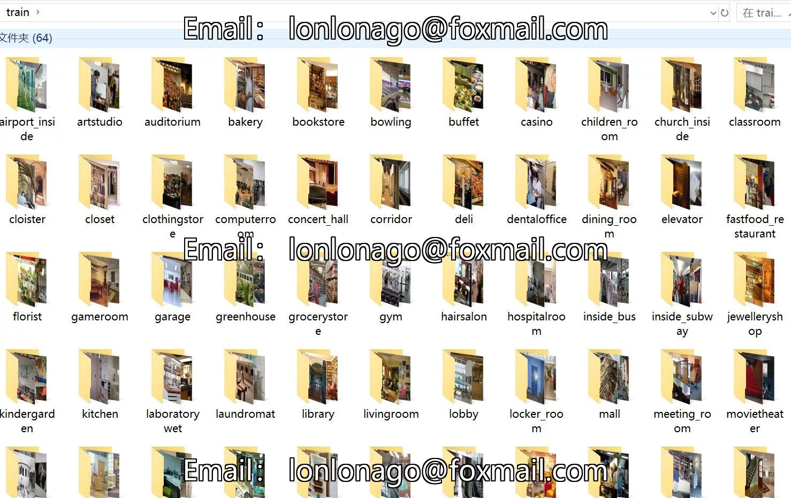
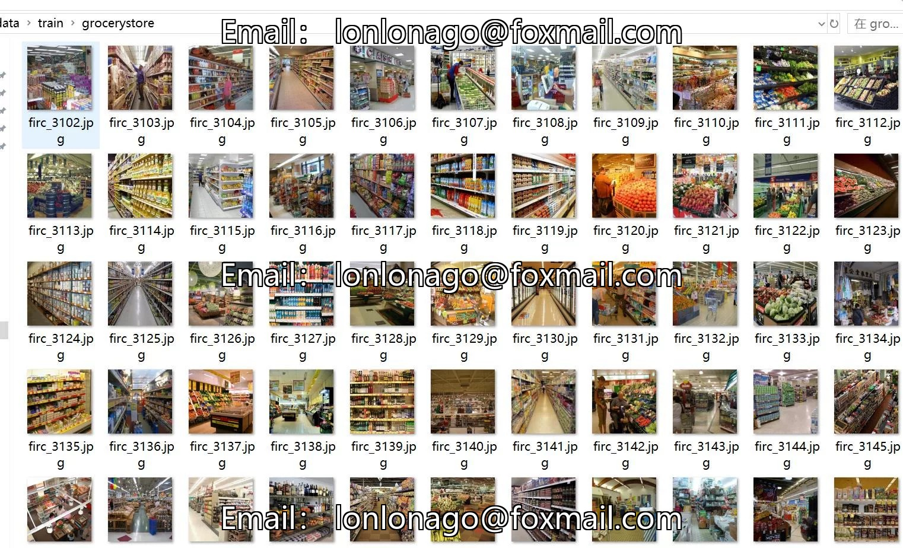
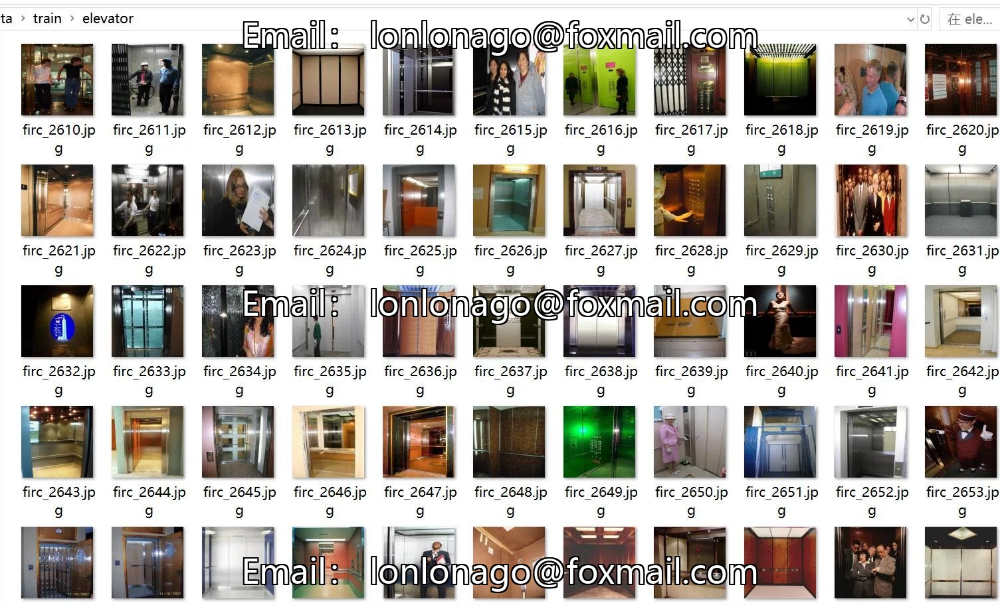

# 64-class indoor scene image dataset with 15,571 images in 64 categories

## Body

64-class indoor scene image dataset with 15,571 images in 64 categories
Warm reminder: Since the dataset is replicabile, please confirm compliance before purchasing.
Dataset type: Image classification for use, not suitable for object detection without labeled files.
Dataset format: Only contains jpg images, each category folder contains corresponding images.
Number of images (number of jpg files): 15,571
Number of categories: 64
Image resolution: 416x416

Category Name: ['airport_inside', 'artstudio', 'auditorium', 'bakery', 'bookstore', 'bowling', 'buffet', 'casino', 'children_room', 'church_inside', 'classroom', 'cloister', 'closet', 'clothingstore', 'computerroom', 'concert_hall', 'corridor', 'deli', 'dentaloffice', 'dining_ro']

om, elevator, fast food restaurant, florist, game room, garage, greenhouse, grocery store, gym, hair salon, hospital room, inside bus, inside subway, jewelry shop, kindergarden, kitchen, laboratory wet, laundromat, library, living room.

'lobby','locker_room','mall','meeting_room','movietheater','museum','nursery','office','operating_room','pantry','poolinside','prisoncell','restaurant','restaurant_kitchen','shoeshop','stairscase','studiomusic','subway','toystore','trainstation','tv

studio', 'videostore', 'waitingroom', 'warehouse', 'winecellar

Number of images per category
Training set image count: 10885
Training set image count: 9795

## Images

## Payment

Here is a pay link on Stripe ( https://buy.stripe.com/3cs8yP7sY87d0vu9AB ). Please contact me lonlonago@foxmail.com after funding $89, and I will send you a complete data files , thank you!

